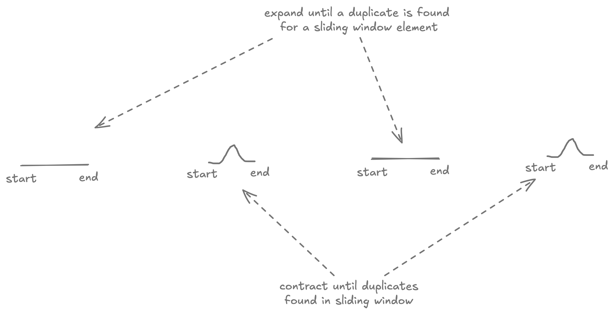

# 3. Longest Substring Without Repeating Characters

Given a string $s$, find the length of the **longest** substring without duplicate characters.

=== "Example 1"

    - Input: s = "abcabcbb"
    - Output: 3

=== "Example 2"

    - Input: s = "bbbbb"
    - Output: 1


=== "Example 3"

    - Input: s = "pwwkew"
    - Output: 3

## Stub

=== "Method"

    ```kotlin
    fun lengthOfLongestSubstring(s: String): Int {
        // Fill here
    }
    ```

## Solution

??? "Expand"

    Sliding-window.
    
    

    ```kotlin linenums="1"
    fun lengthOfLongestSubstring2(s: String): Int {
      var start = 0
      var answer = 0 // (1)
      val seen = mutableSetOf<Char>()
      for (char in s) {
        while (char in seen) { // (2)
          seen.remove(s[start++])
        }
        seen.add(char)
        answer = max(answer, seen.size)
      }

      return answer
    }
    ```
    
    1. longest substring seen so far without a duplicate
    2. If incoming character is duplicate then contract the sliding window until it's not.